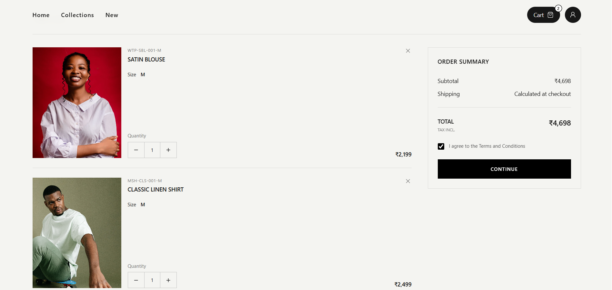
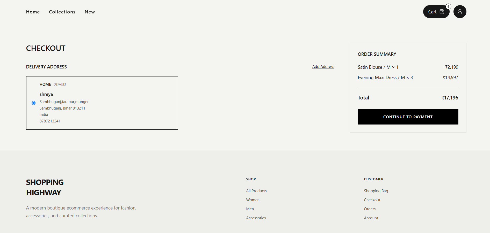
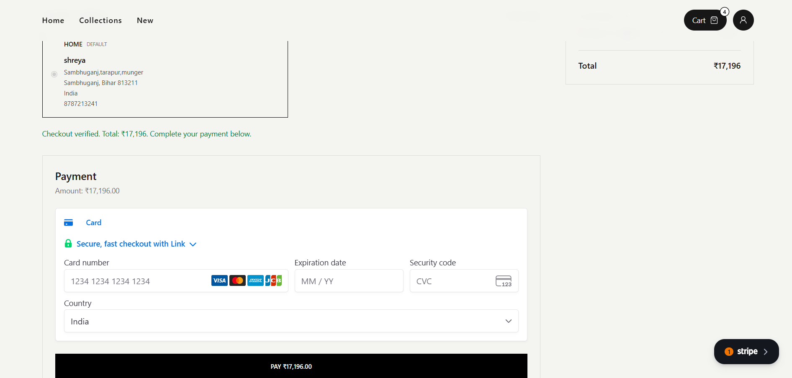

# ShoppingHighway

ShoppingHighway is a full-stack boutique e-commerce application built as a Minor Project. It supports product browsing and filtering, product variants, persistent carts, secure customer authentication, saved delivery addresses, checkout, inventory reservation, and Stripe sandbox payments with webhook-based order confirmation.

## Features

- Customer signup, login, logout, and session restoration
- HttpOnly cookie-based JWT authentication
- Guest cart persistence with localStorage
- Guest cart merge after login/signup
- Product categories and hierarchical category support
- Product variants such as size/SKU
- Variant-level inventory tracking
- Product filtering by category, price, and rating
- Saved customer delivery addresses
- Secure server-side checkout validation
- Pending order creation with immutable shipping-address snapshot
- Atomic inventory reservation to reduce overselling
- Stripe PaymentIntent integration
- Stripe webhook signature verification
- Payment success/failure handling
- Inventory restoration when a pending payment fails/cancels
- Cart clearing after successful payment
- Stripe Payment Element on the React checkout page
- Checkout success notification

## Screenshots

### Home Page


### Products Page


### Product Details Page


### Cart



### Checkout



### Stripe Payment



## Tech Stack

### Frontend

- React
- TypeScript
- Vite
- Tailwind CSS
- Zustand
- Axios
- React Router
- Stripe React SDK

### Backend

- Node.js
- Express
- TypeScript
- Prisma ORM 8 RC
- PostgreSQL
- Neon
- Zod
- JWT
- bcryptjs
- Stripe Node SDK

## Project Structure

```text
ShoppingHighway/
├── screenshots/
│   ├── shoppinghighway-homepage.png
│   ├── shoppinghighway-productpage.png
│   ├── shoppinghighway-productdetailspage.png
│   ├── shoppinghighway-cartitempage.png
│   ├── shoppinghighway-checkoutpage.png
│   └── shoppinghighway-payment.png
├── client/
│   ├── src/
│   │   ├── api/
│   │   ├── components/
│   │   ├── pages/
│   │   ├── stores/
│   │   ├── types/
│   │   └── utils/
│   └── .env
│
├── server/
│   ├── src/
│   │   ├── config/
│   │   ├── controllers/
│   │   ├── routes/
│   │   ├── services/
│   │   ├── validation/
│   │   ├── prisma/
│   │   └── types/
│   └── .env
│
└── README.md
```

## Environment Variables

Never commit real environment files or secret keys.

### `server/.env`

```env
PORT=5000
DATABASE_URL=your_postgresql_connection_string
JWT_SECRET=your_jwt_secret
STRIPE_SECRET_KEY=sk_test_your_stripe_sandbox_secret_key
STRIPE_WEBHOOK_SECRET=whsec_your_local_or_deployed_webhook_secret
```

### `client/.env`

```env
VITE_STRIPE_PUBLISHABLE_KEY=pk_test_your_stripe_sandbox_publishable_key
```

Recommended `.gitignore` entries:

```gitignore
.env
**/.env
node_modules
dist
```

## Installation

Clone the repository:

```bash
git clone <your-repository-url>
cd ShoppingHighway
```

### Install backend dependencies

```bash
cd server
npm install
```

### Install frontend dependencies

```bash
cd ../client
npm install
```

## Database Setup

The project uses PostgreSQL with Prisma.

From the `server` directory, emit the Prisma contract:

```bash
npx prisma contract emit
```

Check migration status:

```bash
npx prisma migration status
```

Apply pending migrations when required:

```bash
npx prisma db migrate --advance-ref db
```

Seed the database if needed:

```bash
npm run db:seed
```

## Running the Application

Use separate terminals.

### Terminal 1 — Backend

```bash
cd server
npm run dev
```

Backend:

```text
http://localhost:5000
```

### Terminal 2 — Frontend

```bash
cd client
npm run dev
```

Frontend normally runs at:

```text
http://localhost:5173
```

## Stripe Sandbox Setup

The backend creates Stripe PaymentIntents and uses webhooks as the authoritative source for payment status.

### Start local webhook forwarding

Install and authenticate the Stripe CLI, then run:

```bash
stripe listen --forward-to http://localhost:5000/api/stripe/webhook
```

Stripe CLI prints a webhook signing secret:

```text
whsec_...
```

Place that value in:

```env
STRIPE_WEBHOOK_SECRET=whsec_...
```

Restart the backend after changing the environment variable.

### Test webhook connectivity

```bash
stripe trigger payment_intent.created
```

A working local webhook should return HTTP `200`.

## Payment Flow

```text
Customer selects delivery address
        ↓
POST /api/checkout
        ↓
Server validates cart, address, stock, and total
        ↓
POST /api/payments/create-intent
        ↓
Create PENDING order
        ↓
Reserve inventory atomically
        ↓
Create PENDING payment
        ↓
Create Stripe PaymentIntent
        ↓
Return clientSecret
        ↓
Stripe Payment Element
        ↓
Customer confirms sandbox payment
        ↓
Stripe sends payment_intent.succeeded
        ↓
POST /api/stripe/webhook
        ↓
Verify Stripe signature
        ↓
Payment → SUCCEEDED
Order → PAID
Cart → cleared
```

If the payment fails or is canceled, the application releases the reserved inventory and updates the pending payment/order state accordingly.

## Money Representation

All monetary values are stored as integer paise.

Example:

```text
369800 paise = ₹3,698.00
```

The same integer amount is sent to Stripe because Stripe expects INR amounts in the smallest currency unit.

```text
Database Payment.amount = 369800
Stripe PaymentIntent.amount = 369800
```

The frontend divides by `100` only for display formatting.

## Important API Routes

### Authentication

```text
POST /api/auth/signup
POST /api/auth/login
GET  /api/auth/me
POST /api/auth/logout
```

### Products

```text
GET /api/products
GET /api/products/:productId
```

### Cart

```text
GET    /api/cart
POST   /api/cart/items
PATCH  /api/cart/items/:cartItemId
DELETE /api/cart/items/:cartItemId
```

### Addresses

```text
GET    /api/addresses
POST   /api/addresses
PATCH  /api/addresses/:addressId
DELETE /api/addresses/:addressId
```

### Checkout and Payments

```text
POST /api/checkout
POST /api/payments/create-intent
POST /api/stripe/webhook
```

## Inventory Safety

Inventory is reserved when a pending order is created rather than after payment succeeds.

The reservation uses an atomic database update conceptually equivalent to:

```sql
UPDATE inventory
SET quantity = quantity - requested_quantity
WHERE variant_id = ?
  AND quantity >= requested_quantity;
```

Only one competing checkout can reserve the final available unit successfully.

If Stripe PaymentIntent creation or payment processing fails, the reservation can be released so inventory is restored.

## Security Notes

- Authentication is derived from the signed HttpOnly cookie.
- Customer IDs are not trusted from frontend request bodies for protected resources.
- Address and cart ownership are checked server-side.
- Product prices and checkout totals are calculated from database values.
- Stripe secret keys are server-only.
- Stripe publishable keys are frontend-safe but are still stored through environment configuration.
- Stripe webhook signatures are verified using the raw HTTP request body.
- The webhook route is registered before `express.json()`.

## Build

### Backend

```bash
cd server
npm run build
```

### Frontend

```bash
cd client
npm run build
```

## Current Development Status

Implemented:

- Authentication
- Guest and authenticated carts
- Product variants and inventory
- Saved addresses
- Checkout validation
- Inventory reservation
- Order and payment records
- Stripe PaymentIntent creation
- Stripe Payment Element
- Stripe webhook verification
- Successful payment processing
- Failed/canceled payment compensation
- Checkout success UI

Planned/improvable areas:

- Dedicated order/payment result page
- Order history UI
- More detailed order-status polling after payment
- Stronger address validation
- Lighthouse/performance reporting
- API/Postman documentation

## License

This project was created for academic/educational purposes.
